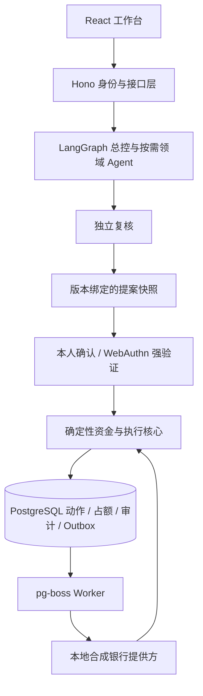

# 安心办 BankPilot

**带资金约束的银行事务智能体。** 面向银行 AI 智能体比赛的本地合成银行原型。用户用自然语言提出需求，总控按需调度转账、账单、理财、卡片、订阅和生活目标六领域 Agent，再由独立复核检查提案。金额计算、资金保护、权限判定、本人授权与交易执行由确定性程序完成。

- 比赛仓库：https://github.com/1hb6s7t/BankPilot
- [最终提交材料](https://github.com/1hb6s7t/BankPilot/blob/main/artifacts/submission/README.md)
- [部署说明](docs/deployment.md) · [测试与证据](docs/testing.md)
- [技术设计](docs/submission/technical-design.md) · [安全自评](docs/submission/security-self-assessment.md)

## 功能

| 模块 | 当前实现 |
| --- | --- |
| 工作台 | 账户概览、资金保护分配、自然语言办理、结构化确认卡、回执与审计 |
| 转账 | 收款人消歧、精确金额、累计风险分级、本人确认、幂等执行、未知结果查单 |
| 账单 | 按条件查询、分类与周期支出提示、原始记录引用 |
| 理财 | 合成持仓查询、逐笔强验证赎回、受理与结算到账分离 |
| 卡片与订阅 | 卡片挂失/解挂强验证；订阅查询授权、取消与银行拦截分别记录 |
| 生活目标 | 持久化任务依赖、到账后准备下一步、逐动作授权与局部重规划 |

系统使用合成账户、银行账本和商户数据，没有连接真实银行。受控模型演示、自动化测试与真实云模型回归分别记录。当前未完成云模型生成到资金执行的完整端到端验收，不作生产可用或正式银行合规认证声明。

## 技术架构



Agent提出建议，不能自行生成有效授权证明。模型输出经过结构校验、证据校验和业务复核后，仍需走授权与资金检查。结果未知时保留原请求身份和必要占额，先查原单。

复用LangGraphJS、PostgresSaver、pg-boss、Better Auth、SimpleWebAuthn、assistant-ui、Hono、Zod、React和PostgreSQL。精确版本见`package.json`与`pnpm-lock.yaml`，来源与许可证见[第三方声明](THIRD_PARTY_NOTICES.md)。

## 本地运行

需要Node.js 24+、pnpm 11.25.0、Docker与Docker Compose。首次安装需要联网获取依赖和数据库镜像。

```sh
pnpm install --frozen-lockfile
cp .env.example .env
```

将`.env`中的`BETTER_AUTH_SECRET`改为至少32字符的随机值。确认本项目55432端口可用，再初始化本地合成演示库：

```sh
pnpm db:up
pnpm setup
pnpm demo
```

打开http://localhost:5178，API使用8787端口。`setup`仅用于本项目演示库，切勿指向其他项目或真实业务数据库。需独立动态端口和状态目录时，使用[隔离部署流程](docs/deployment.md)。

真实云模型模式需在本机`.env`配置`BANKPILOT_MODEL_BASE_URL`、`BANKPILOT_MODEL_NAME`和`BANKPILOT_MODEL_API_KEY`，并单独验证服务权限与可用性。密钥不包含在仓库或提交包中。默认隔离测试不需要云模型配置。

## 测试与验证

```sh
pnpm test:isolated
```

该入口不读取`.env`，默认剥离云凭据，在本机55432端口的PostgreSQL中创建专属测试数据库，执行类型检查、Vitest与前端构建，并核对数据库归属后清理。不要在未配置隔离测试数据库时直接运行整个`pnpm test`。

2026-10-28，包含新版工作台的独立源码副本完成冻结锁文件安装：**135个测试文件、3426项测试全部通过，类型检查、构建与测试库清理通过**。本轮未调用云模型、未运行浏览器扩展，验证发生在同一开发Mac的独立目录。见[当前验证记录](docs/evidence/2026-10-28-submission-source-verification.json)。

真实云模型既有证据为2026-10-26固定已知8例回归8/8通过，20次HTTP 200、零重试。它不等于盲测、长期稳定性或资金执行验收，见[模型回归记录](docs/g9w-provider-revalidation.md)。

## 比赛演示

最新ShotCraft V4为1080p/30fps、167.77秒。新版界面的实际状态截图展示：初始8000元、保护5000元；300.25元本人确认后余额7699.75元；第二笔600元超时，当前页查询原单后余额7099.75元、占额归零。提供方仍只有两笔付款。

影片持续标注“本地合成银行 · 受控模型”，采用状态截图剪辑而非连续录屏。本次两笔均为黄档确认，未使用Passkey。PPT、视频、PDF与独立源码ZIP统一在[最终提交目录](https://github.com/1hb6s7t/BankPilot/blob/main/artifacts/submission/README.md)。

## 目录

| 目录 | 用途 |
| --- | --- |
| `apps/web` | 中文工作台、聊天、授权与回执 |
| `apps/api` | 身份、输入契约、提案持久化、WebAuthn |
| `apps/worker` | 后台执行与恢复 |
| `packages/agents` | 总控、领域规划、独立复核与模型适配 |
| `packages/core` | 风险、授权、占额、幂等、账本与状态机 |
| `packages/contracts` | 金额、动作、提案与接口类型 |
| `tests`、`evals` | 测试用例、受控评测与必要历史基准依赖 |
| `docs/submission` | 本次技术与安全文稿 |

历史报告按各自日期与源码版本解释，不自动代表当前候选重新验收。报名系统正式提交与回执由提交者另行确认。
