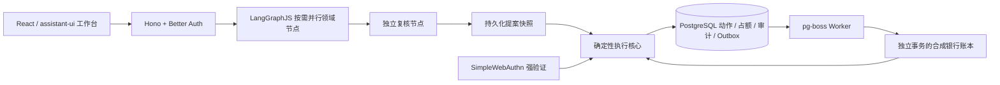

# BankPilot · 安心办

**完整源码与测试包入口：** [安装、隔离测试与演示部署](docs/g9v-source-test-handoff.md)。

带资金约束的银行事务智能体，面向比赛的本地合成银行沙箱。采用总控、六领域与独立复核 Agent，复用 LangGraph、PostgreSQL、Hono、Better Auth、React 等基础设施，由确定性程序负责资金计算、授权和执行。

**当前候选状态：新密钥下八例真实模型回归通过，源码与资金验证分别完成。** 2026-10-26 G9W固定八例已知代表回归8/8通过，共20次HTTP200、零重试；G9V较早8次403记录保留。独立源码副本完成类型检查、134文件3420项测试和构建，测试库已清理；实际合成赎回到账后独立确认付款、UNKNOWN查原单两项在scripted模式通过。详见[G9W报告](docs/g9w-provider-revalidation.md)与[提交清单](docs/submission-readiness.md)。当前仍为提交候选，未见样本、完整云模型资金执行链与接收方复现分别待证。

**比赛仓库：** [1hb6s7t/BankPilot](https://github.com/1hb6s7t/BankPilot)。[提交材料](artifacts/submission/README.md)包含188字符简介、技术与安全文稿、10页PPT（计划8分50秒）及约2分15秒演示视频。比赛截止日期11月2日来自用户确认，尚无门户提交回执。

**最新验证：G9R完成三个独立账号约一分钟的持续查询。** 固定720次账户/账单/持仓GET全部有效，总体P95为71ms；逐账号核对独立数据库预期ID、账单证据引用和持仓绑定，未出现所检查字段串户。只是本机、最多12并发的有限查询负载，不代表生产容量或并发支付验证。原库49表97命令保持，测试环境已清理，产品仍为G9Q版本。详见[G9R报告](docs/g9r-multiuser-read-validation.md)。

**最新优化：G9Q已将聊天界面改为登录后按需加载。** 未登录主JS实际gzip响应体由227027降到118328字节，减少47.88%；5个浏览器context均未提前下载聊天模块。102项相关状态测试、类型检查/构建通过，真实生产预览的登录、聊天切换、重登、慢chunk时退出及chunk失败后显式刷新恢复1/1通过；没有新增云调用或支付验收。详见[G9Q报告](docs/g9q-lazy-chat-validation.md)。原网络附件有一个计数标签错误（含历史GET的11次），已保留并按method=POST纠正为实际1次消息提交。

**最新测量：G9P完成生产首屏与有限查询负载基线。** 5个全新浏览器context均有效，登录可用时间中位数59.6ms；72次业务GET全部有效，并发1/4/8时P95为9/21/41ms。仅本机短批次、无模型调用，不代表生产SLO或容量上限。32业务表中31张摘要一致，首次dashboard查询初始化一条零用量记录，因此不称数据库严格只读；原库49表97命令保持。该次测量使用G9O候选，详见[G9P报告](docs/g9p-performance-baseline.md)。

**最新修复：G9O已解决同一页面交易完成后仍显示旧“等待执行”提示的问题。** 仅三个页面10行提示文案变化，当前状态与回执继续来自原动作；全仓类型检查/构建通过，新导出副本的真实同页浏览器1/1通过，现金AUTHORIZED→SUCCEEDED、赎回AUTHORIZED→SETTLING、注册提示保留和五项管理授权均有断言及截图。详见[G9O报告](docs/g9o-notice-validation.md)。原GLM配置保留，最近真实请求仍为HTTP502，本轮云调用0，候选未发布。

此前[G9N](docs/g9n-delivery-validation.md)在旧候选包完成现金付款、五项管理授权和原单重启恢复分项验证。测试分别修正状态提示选择器与窄屏菜单操作后，INITIAL 1/1、RESTORED 1/1；首轮失败保留。独立赎回实际未到期，后继付款未发生，不算筹资全链完成；G9O未重复运行重启验收。

**开发进度：G9L完成候选运行包、新副本安装与待结算真实重启验证；G9M新GLM配置已保存，唯一只读真实调用在语义阶段返回HTTP502。候选未发布。** 本次仅派发1次，卡片Agent和复核尚未运行，不代表GLM业务能力已通过或已失败；详见[G9M报告](docs/g9m-provider-validation.md)。86源文件运行包已导出校验，独立store安装257包、类型检查/构建通过。旧完整交付INITIAL因周日T+0未即时到账失败并保留；同一待结算原单在真实stop/start前后各1/1通过，原授权/占额/余额不变，不能替代完整到账付款。详见[G9L报告](docs/g9l-validation.md)。此前G9K的16/36、9/12与订阅live1/1、G9L四槽0/4均属于旧DeepSeek服务，不能外推新GLM。以下旧阶段数字仅属历史证据。

**已完成阶段：G9G 候选冻结但未发布。** 120文件、3165项自动化测试、类型检查与构建通过；评测入口最后调整另有26项定向复测。真实已知36例三套评分为原G9 **32/36**、G9E **34/36**、G9G **35/36**，1例账单分支截断不可评；补充12例三套评分均 **12/12**，全部可评。完整证据见[G9G报告](docs/g9g-validation.md)。

当前用户指定云模型为 `https://apiw.pro/v1` / `deepseek-v4.1-flash`，配置已写入被 Git 忽略的本地 `.env`，当前真实验证见 [G9U 报告](docs/g9u-provider-validation.md)。历史评测成绩不回填为本次结果。真正未见质量、其他同版云恢复、容量、完整交付路径与接收方验收仍未完成。

当前可审查的[G9Q候选运行源码包](artifacts/BankPilot-G9Q-candidate-runtime-source-20261025.zip)与[SHA256](artifacts/BankPilot-G9Q-candidate-runtime-source-20261025.zip.sha256)含86运行源文件和外层版本/来源说明，已包含提示修复与聊天按需加载，不含.env、依赖或私有状态。进入解压后的`runtime-source/`按其安装说明运行；包内G8I说明保留历史身份，实际当前结果以外层README、VALIDATION和[G9Q报告](docs/g9q-lazy-chat-validation.md)为准。旧[G9K/R2源码包](artifacts/BankPilot-G9K-candidate-runtime-source-20261025-r2.zip)保留；新包不是正式发布、空机器/接收方验收或比赛提交。

**运行状态：最近实查原演示端口5178/8787未监听，工作区是未发布候选；不能将测试环境称为在线演示。** 本轮订阅浏览器使用随机独立数据库，清理已验证；原演示库49张表与97条命令全部摘要保持。手动启动会加载当前工作区，而不是历史G9B版本。

阶段报告按各自当时版本解释，不自动视为当前回归：

| 阶段 | 主要证据与边界 |
| --- | --- |
| [G9F](docs/g9f-validation.md) | 订阅查询授权后的原请求续办；3019项测试，受控闭环1/1；旧凭据403保留，新凭据同冻结版本云闭环1/1、22.922秒。 |
| [G9E](docs/g9e-validation.md) | 2791项测试，受控六域6/6与账单4/4；真实36例原32/新33，补充12例9，两组共3例不可评；云浏览器2/3。 |
| [G9D](docs/g9d-validation.md) | 2535项测试；同版default与none对照分别32/36+10/12、31/36+8/12，未通过切换门槛。 |
| [G9B](docs/g9b-validation.md) | 2099项测试，云浏览器3/3，已知36例25/36；当时演示曾加载G9B，该运行状态不是当前状态。 |
| [G9首轮](docs/phase9-verification.md) | 36例未见首测11/36；该集随后已暴露，后续成绩均属已知回归。 |

更早阶段和完整剩余目标见[理想状态验收基线](docs/ideal-state-acceptance.md)。[G8I源码包](artifacts/BankPilot-G8I-runtime-source-20261023.zip)及[安装说明](docs/g8i-clean-delivery.md)是历史交付，不含之后改动。本轮没有比赛提交或接收方验收结果。

## 启动

要求 Node.js 24+、pnpm 11.25.0、Docker。当前工作区已经初始化 `.env` 和独立 PostgreSQL，直接运行：

```sh
pnpm db:up
pnpm setup
pnpm demo
```

打开 **http://localhost:5178**。请使用 `localhost`，以匹配 WebAuthn RP 与可信 Origin。

演示账户：`bankpilot@example.test`，密码：`BankPilot-demo-2026!`。所有账户、联系人与金额都是合成数据。`setup` 可重复执行，不会重置已有余额、动作或回执。

首次从全新副本安装时：

```sh
pnpm install --frozen-lockfile
cp .env.example .env
# 将 .env 的 BETTER_AUTH_SECRET 替换为随机值，例如用 openssl rand -hex 48 生成。
pnpm db:up
pnpm setup
pnpm demo
```

若当前终端没有 Node，而在同一台 Codex 工作机运行，可先执行：

```sh
export PATH='/Users/auriel/.cache/codex-runtimes/codex-primary-runtime/dependencies/node/bin':"$PATH"
```

前端 5178、API 8787、PostgreSQL 55432 均仅监听本地。PostgreSQL 使用独立 `bankpilot` Compose 项目与持久卷；其他已有项目不受影响。`pnpm demo` 启动 Web、API 与 Worker，后两者不自动热重启，适合演示和验收。修改服务端代码后需手动重启；日常开发可用 `pnpm dev` 启用热重启。

## 演示流程

1. 输入“给林晓转600元”，核对收款人和金额，点击“确认并执行”。资金真实写入合成银行数据库。
2. 再输入“给林晓转600元”。按上海业务日计算，日累计含本次超过 1,000 元，需要红档强验证；先注册 Passkey，再用本机验证器授权。
3. 在“下一笔执行故障”选择“记账后超时”，点击应用，再授权一笔转账。银行先记账，应用进入 UNKNOWN 并保留占额；手动查单或等待 Worker 约 15 秒恢复，不能重复扣款。
4. 刷新页面，账户、动作、回执、审计、最近一次已完成计划的 Agent 事件及资金/账单证据从数据库恢复。聊天原文和助手答复也按账号与聊天保存；在“选择聊天”中恢复，当前动作状态通过“查看计划”重新读取。
5. 输入“查本月账单，给林晓转600元，不影响房租和生活费”，并行激活转账、账单和资金计划节点，独立复核后生成待授权动作。历史账单有单独来源，绝不重复加减当前余额。
6. 输入“给张伟转300元”，两个同名联系人将触发澄清；可补充“工商银行”或尾号 `3361` 消歧。
7. 打开“账单”，查看分类、可能重复与可能周期支出，点击原记录 ID 跳到本期或上月原始证据。规则提示不是已确认的重复扣费或订阅关系。
8. 打开“资金计划”，默认演示保护生活费 2000 元及未来房租 3000 元。编辑后必须点击“确认并保存规则”；版本冲突会重新加载，避免覆盖他人更新。输入“给林晓转4000元，不影响房租和生活费”，余额 8000 元时缺口为 1000 元，不能创建可执行计划。
9. 打开“联系人”，为林晓输入“房东”，生成候选并核对后确认保存；此后可输入“给房东转300元”。别名仅当前用户可见，保存别名本身不会发起转账。
10. 打开“卡片”，准备挂失或解挂，再逐动作完成 Passkey 强验证；普通确认不能代替强验证。也可输入“挂失尾号2026银行卡”，或用“查询银行卡状态”查看已有状态。卡片挂失不会取消商户合同。
11. 打开“订阅”，先准备查询并明确确认，服务端开放 5 分钟查询授权。云音乐支持本地合成商户取消；城市健身合约可单独确认银行拦截。两种状态分别展示，任何操作均不会把未来节省金额加进余额。刷新后先隐藏订阅明细，可点击“查看已授权订阅”复用仍有效的原查询授权；过期后需重新授权。
12. 查询确认后，输入“取消云音乐订阅”生成待确认提案，并在计划区确认；没有有效查询授权时只会先生成查询候选。当前应写明“订阅”或“扣款”，裸商户简称会安全澄清。刷新后恢复最近一次完成计划与各动作最新状态。

13. 打开“理财”，T+0/T+2 都是明确标注的固定面值合成持仓。输入赎回金额，预览后逐笔通过 Passkey。T+2 显示“结算中”并保留占仓，预计款项不增加现金；到期后提供方入账、核验回执，再同步本地余额。T+0 同样经过真实合成账本与回执流程。
14. 打开“生活目标”，填写收款人、金额、明确截止日，以及可选的赎回来源。系统准备首个就绪动作，每笔分别授权。赎回到账后点“检查进度并准备下一步”，再核对并授权转账。修改后续金额可保留成功赎回；若需改变已准备的待确认动作，先明确取消该候选，再重规划。未知或已派发动作不能换单。
15. 可以输入“为林晓建立生日目标，2026-11-21前给林晓转账300元，先赎回T+0理财300元”（日期应晚于当前日）。提案通过复核后，在计划区点击“查看生活目标计划”。缺日期、同名收款人、多金额或不明确产品会要求澄清，不会退回立即转账。

## 架构与复用



规划拓扑为总控路由 + 六个领域角色 + 独立复核。只激活相关领域；领域间交换结构化提案，不共享任意写权限。六领域是转账、账单、理财、卡片、订阅和生活目标；转账具备执行闭环，账单可查证分析，资金计划可保护预算，卡片与订阅已接入版本绑定的管理动作。理财支持本人持仓查询、逐笔强验证赎回、受理与实际到账分离；生活目标通过持久化 DAG 关联赎回、实际到账等待与独立授权转账，支持保留原回执的局部重规划。

直接复用 LangGraphJS、PostgresSaver、pg-boss、Better Auth、SimpleWebAuthn、assistant-ui、Hono、Zod、React、Vite 与 PostgreSQL；自行开发金额与风险规则、动作哈希、资金占额、授权绑定、模拟银行适配、未知结果恢复及验收断言。精确版本见 `package.json` 和 `pnpm-lock.yaml`；基础许可证信息见 `THIRD_PARTY_NOTICES.md`。开源调研与 A/B/C 分类保留在 `research/2026-10-22/`。

目录分工：

| 目录 | 作用 |
|---|---|
| `apps/web` | 中文工作台、聊天、确认卡、Passkey、回执、审计 |
| `apps/api` | 身份校验、输入契约、提案快照与租约、WebAuthn |
| `apps/worker` | pg-boss 执行与恢复进程 |
| `packages/contracts` | 金额、动作、提案、API 服务类型 |
| `packages/agents` | 按需并行规划、独立复核、可选模型适配、持久化 PoC |
| `packages/core` | 风险、授权、占额、幂等、账本与状态机 |
| `tests` | 真实 PostgreSQL、API、编排与浏览器验收 |

## 已实现的执行约束

- 金额以整数分字符串传输、数据库 bigint 保存。上海业务日累计成功和已授权在途加本次，≤100000 分为黄档，否则红档。
- 草稿只预览风险。授权时按用户串行锁重新计算累计与可用余额；并发两笔 600 元不能都获得黄档授权。升级时更换动作版本/哈希，必须重新验证。
- API 身份来自 Better Auth 会话。客户端不能指定用户或强验证等级。红档使用真实签名、Origin/RP 校验、UV 和一次性挑战；挑战绑定动作哈希。
- 授权、占额、审计与 Outbox 同事务；Outbox 到 pg-boss 的投递也在同一数据库事务中完成。
- 同一命令同参返回原动作，异参拒绝。队列重投沿用同一个银行请求号。
- 规划提案先持久化，再创建动作；崩溃重试重放原快照，租约令牌阻止旧运行覆盖新结果。
- 超时后先查原单。SUBMITTING/UNKNOWN 不能取消或因到期释放占额；普通查无记录不会被冒充确定失败。已结算动作不可回滚。
- 核验回执中的原请求、收款人、金额、币种；成功后写回应用余额并释放在途占额。
- 资金保护覆盖最低生活保留、未来30天及逾期未清义务。预期收入不计入当前可用余额，预演不占额；授权和派发前都会在用户锁内重算，派发前策略变化可阻止扣款，已派发UNKNOWN只查单。
- 管理动作绑定用户、目标、操作、资源版本与有效期；卡片操作为红档，别名保存、订阅查询/取消/拦截为黄档。确认时重新检查版本及查询授权；成功重试不重复操作，也不延长查询授权。
- 订阅的商户合同、银行扣款限制与卡片状态分别保存。当前商户适配器是同数据库事务内的合成实现，状态、回执和审计原子提交，不代表真实商户接口已接通；周期扣款调度尚未实现。

- 赎回使用独立占仓、证明与 Outbox；提供方赎回双边分录与本地余额分别原子落账。`SETTLING` 表示已受理未到账，`SUCCEEDED` 才表示实际入账。回执绑定请求、账户、持仓、金额、产品和成熟时间；未知结果只查原单。
- 日期预演使用上海日期与 `DEMO_WEEKDAYS_V1` 合成周一至周五日历，未包含法定节假日。预计线与保守线分开，不自动支付义务。
- 目标节点使用稳定命令和独立版本，恢复会找回“子动作已创建但节点引用尚未保存”的原动作。重规划不暗中取消动作；已授权、未知、已成功节点的关键身份不能替换。

## 验证

```sh
pnpm typecheck
pnpm test
pnpm build
# 先保持 pnpm demo 运行；首次需要 pnpm exec playwright install chromium
pnpm test:e2e
pnpm eval:scripted
# 显式使用 .env 指定的真实云端模型，产生供应商调用
pnpm eval:live
# 新增 8 个独立管理场景，复用同一个评测器
pnpm eval:management:scripted
pnpm eval:management:live
# 理财/目标固定 8 例
pnpm eval:phase4:scripted
pnpm eval:phase4:live
# G5：冻结40例 × 3种编排的脚本对照
pnpm eval:ablation:scripted
# 预选12例 × 3种编排，调用指定云端模型，保留所有失败
pnpm eval:ablation:live
# G6：已知40例回归、新24例首次结果与修复后回归分开记录
pnpm eval:g6:regression
pnpm eval:g6:scripted
pnpm eval:g6:postfix
# 预选12例，仅正式并行+独立复核拓扑；保留未识别路由和所有失败
pnpm eval:g6:live
```

`pnpm test` 使用确定性适配器/HTTP模拟，不调用云端模型。`eval:live` 明确调用真实模型；浏览器 E2E 跟随正在运行的应用模式，本工作区会实际调用云端。Core、Agent 和 API 测试使用独立 schema / 随机用户；浏览器使用独立合成用户，不修改演示账户余额。WebAuthn 测试生成真实签名，未伪造服务端验证成功状态。第一阶段历史记录见 `docs/phase1-verification.md`；第二阶段结果见 `docs/phase2-verification.md`；第三阶段契约见 `docs/phase3-contract.md`、结果见 `docs/phase3-verification.md`；第四阶段契约见 `docs/phase4-contract.md`、结果见 `docs/phase4-verification.md`，逐样本结果在 `evals/results/`。

## 可选真实模型接入

在 `.env` 配置以下显式变量，重启 API。基础 URL 可以是服务根站（自动补 `/v1`），或服务方给出的 `/v1` 前缀。凭据仅留在被 Git 忽略的本地 `.env`；示例文件不含密钥。

```dotenv
BANKPILOT_MODEL_BASE_URL=
BANKPILOT_MODEL_NAME=
BANKPILOT_MODEL_API_KEY=
BANKPILOT_MODEL_OUTPUT_MODE=json_object
BANKPILOT_MODEL_TIMEOUT_MS=45000
BANKPILOT_MODEL_MAX_ATTEMPTS=2
```

领域节点与复核节点支持 `tools` 与显式 `json_object` 结构化输出。本工作区根据提供方对照测试明确配置为 `json_object`，不会在失败后自动切换模式。瞬态错误有限重试；拒绝、结构错误和失败都有明确错误码。报表和资金事实由确定性服务渲染，模型自由叙述单独记录为辅助说明；模型不能覆盖预算拒绝。每次调用记录耗时与供应商报告的 usage，缺失或0不代表免费。当前所有运行时角色共用同一指定模型；开发阶段的模型和推理强度分工不等于产品已有多供应商自动路由。

## 下一阶段

当前优先修复新模型已知回归中的四项业务失败：g719/g723 必需事实遗漏、g721/g722 生活目标被提前澄清（g722 也遗漏事实）。保持原样本、评分与预算，再跑已知回归；实现稳定后另建独立冻结的新未见样本，并验证真实云浏览器流程。随后接续性能容量、新交付包、接收方环境和比赛材料。本地恢复和连接验证已经完成的范围见页首，下列 G5–G7 内容保留为历史阶段演进。

G5 已增加冻结样本、三种编排对照和脱敏 provider 诊断。协议见 [phase5-contract.md](docs/phase5-contract.md)，首次结果与修复后回归见 [phase5-verification.md](docs/phase5-verification.md)，逐项失败见 [phase5-findings.md](docs/phase5-findings.md)，演示流程见 [phase5-demo.md](docs/phase5-demo.md)。三组共用确定性解析和资金门禁；消融模式只用于评测，生产仍固定带独立复核。评测不直接执行交易，不能把未测的越权写入或重复扣款指标当作0。

G6 已修复 G5 留下的12项语言入口问题：金融大写金额、相邻分句金额/尾号绑定、持仓只读查询、服务端产品简称、卡状态/恢复与自动续费路由，以及扣款通道的领域误激活。已知40例三种编排均通过；但独立新24例首次仅8/24通过，预选12例真实模型仅2/12通过，泛化验收没有通过。模型实际被调用的4例共8次结构化返回成功，其余8例未路由到模型，不能把零调用计为模型成功。

新集发现的历史账单订阅误提案已作限定修复：路由、商户补充识别及订阅解析共享同一语境过滤；修复后仍8/24，但不符合标签的动作提案由每种条件1例降至0例。浏览器完整首轮6/7通过，新增流程曾遇到模型无效JSON；同一代码针对性重测1/1通过。首轮与后续结果独立保存，不重写标签。完整证据见 [phase6-verification.md](docs/phase6-verification.md)、[phase6-findings.md](docs/phase6-findings.md)，新集契约见 [phase6-contract.md](docs/phase6-contract.md)。已用过的集合现在是回归集。

G7 的优先项是把口语意图识别与确定性实体/金额校验分层，处理“打个三百零七块五”、仅产品名查询、产品名含“计划”、搬家筹资等入口，以及缺数据/多月份请求的明确澄清。实施前重新核对可复用框架能力，保留独立复核与每笔授权，再另建未见集合验证。已有 PostgresSaver 中断恢复仍为独立 PoC，主业务由 API 提案快照和 Core 动作持久化恢复；G8A 已增加应用聊天持久化，长期对话图检查点、真实银行/商户适配和生产验收尚未完成。

## G7 阶段记录（2026-10-23）

生产云模型路径已接入原文语义解释、确定性字段校验、相关领域并行与独立复核；模型结构错误可以在同一预算内一次重新生成。截至 G7 局部修复批次，709/709 自动化测试、typecheck 和三个真实云模型浏览器流程通过；后续 G8 结果单独记录。资金查询明确区分账户余额、保护金额与可安排额度；语义和下游实际调用阶段共享 32,768 token 的请求上限预算，全部重试计入。

语言质量仍未验收完成：历史首轮 live12 为 2/12；G7 v3 已知 12 例严格通过 8/12，保留 12 例首次执行严格通过 7/12。预算、协议和源码不同，不作严格同条件提升对照；保留集标签理由曾向实现方暴露，不称完全盲测。G7 局部修复后的浏览器 3/3 与首测 1/2 分开保留；后续 G8B 完整 24 例已知回归为 16/24，新阶段另见下文。详见[修订验证](docs/phase7-refinement-verification.md)、[首轮阶段报告](docs/phase7-verification.md)和[首轮失败分析](docs/phase7-findings.md)。继续使用原有 `pnpm demo` 启动；`pnpm eval:g7:live` 会调用配置的模型，历史结果与对应冻结源码保留在 evals 下。

## G8A / G8B 阶段记录（2026-10-23）

完整聊天原文、助手答复、失败记录与原命令已落 PostgreSQL；前端恢复服务端历史，未知响应沿用同一消息 ID，恢复不会重新授权。明确选择待补充请求后，可补单笔转账的收款人/金额，或无赎回依赖目标的完整日期；只补允许字段，原金额与字段来源保留，两个页面并发回答只能有一个后继。当前需要一次补齐该问题的全部缺失字段，其他类型需完整重述。

切换账号/聊天会清空旧状态并拒绝迟到响应；退出过程中刷新会优先完成退出。进程终止后 pending 或过期 running 命令保存在数据库，用户通过明确重试恢复；重复消息 replay 不会隐式接管租约。

G8B 冻结版全仓自动化 **889/889（39 文件）**、typecheck、前端 build 通过；其中恢复专项 **8 文件、40/40**。已验证两个提交前 checkpoint 迁移 SIGKILL 窗口、生产图 reviewer/并行领域中断后的新进程显式恢复，以及真实 SIGTERM/SIGINT 排空。完成分支的实际输出在当前 checkpoint 持久化后，恢复不重跑它。生产图恢复默认关闭，需 `BANKPILOT_CHECKPOINT_RECOVERY=true` 启用；数据库断连、提交响应未知及图内澄清 interrupt 仍未验收。

历史 G8 六流程云模型浏览器为 **1/6**，其余 5 项当时遇到上游 HTTP 520/521；后续 G8C v1、v2 浏览器各为 **5/6**，失败分别涉及赎回产品词误判和示例误判。G8B 的原 24 例语言用例按已知回归为 **16/24**，G8C v1 为 **19/24**；G8D 同一已知回归为 **19/24**，都对应各自冻结版本，不改写浏览器历史或代表未见泛化。G8D 自动化为 **1218/1218（50 文件）**，typecheck/build 通过，135 文件源码冻结。真实回归的 62 次尝试中 53 次成功、9 次 HTTP 502；结果、源码哈希和逐次记录经独立复算，见[审计数据](evals/results/2026-10-23-g8d-live-audit.json)。详情见 [G8 验证报告](docs/phase8-verification.md)、[G8C 阶段报告](docs/g8c-semantic-completion.md)、[G8D 可靠性报告](docs/g8d-semantic-reliability.md)及[G8B 恢复记录](docs/g8b-checkpoint-fencing.md)。完整目标与未完成项见[验收基线](docs/ideal-state-acceptance.md)，实施契约和复用依据见[恢复契约](docs/phase8-contract.md)、[开源复用](docs/phase8-reuse.md)。

## G8C 阶段记录（2026-10-23）

已增加完整原文覆盖检查、明确月份选择、受限账单期间重生成，以及直接引用流水的商户/类别支出、最大单笔和两月类别增量分析。部分账单显示数据截止提示，缺失月份不显示零消费。G7 评测入口的每次模型调用另有持久化开始/结果记录，未闭合调用保留为结果未知；当时应用 API 尚未接入这个独立日志；G8E 已新增应用内的逐次预留、失败和未知结果记录。

G8C v1 通过 **1039/1039（46 文件）**、typecheck/build，冻结 130 文件；真实模型全 24 例已知回归为 **19/24**（两组 10/12、9/12），五项业务失败仍需修复。v1 六流程浏览器为 **5/6**，赎回流程因内置产品名误判失败。v2 自动化 **1091/1091（47 文件）**、typecheck/build 通过并冻结 131 文件；六流程浏览器仍为 **5/6**，赎回流程通过，示例转账被误判为失败。v2 没有重跑 24 例，不能沿用 v1 分数作为 v2 成绩。版本细节和原始证据见 [G8C 阶段报告](docs/g8c-semantic-completion.md)。

## G8D 历史进展（2026-10-23）

统一自动化 **1218/1218（50 文件）**、typecheck/build 通过，135 文件源码冻结于 [G8D 快照](evals/baselines/g8d-semantic-2026-10-23T08-38-10-627Z/source-manifest.json)。真实 24 例已知回归严格通过 **19/24**，失败为 g703、g710、g711、g712、g722；按组为 pilot-known **9/12**、reserved-known **10/12**。62 次尝试全部闭合，53 成功、9 次 HTTP 502；9 次错误调用缺少 usage，不能计为零费用，reported zero input usage 也不代表零费用。该组是已知回归，不能作为未见泛化结果。全量独立重算见[审计数据](evals/results/2026-10-23-g8d-live-audit.json)，阶段索引见 [G8D 可靠性报告](docs/g8d-semantic-reliability.md)。

G8D 六条既有云模型浏览器流程为 **6/6**（302.72 秒，0 retry/skip/flaky），135 个冻结源码文件及快照副本均无漂移。结构化响应有 **7 个唯一 PlanResult、18 条返回的 ModelRun（15 成功、3 失败）**：转账复核一次 schema 失败后重试成功；资金只读查询的复核连续两次 HTTP 502，但确定性余额事实正确、`effectiveApproved=false` 且没有动作。它们是六条现有 UI 断言通过，不是六领域执行验收，也不证明模型调用全部成功；ModelRun 来自应用响应而非独立持久化调用账本。[浏览器报告](evals/results/2026-10-23-g8d-browser-six.json)、[响应摘录](evals/results/2026-10-23-g8d-browser-six-responses.json)、[独立审计](docs/evidence/2026-10-23-g8d-browser-audit.json)。受控 API/PG 探针还复现了模型阶段两次 502 被保存为 `complete`、`retryable=false`，修复端点后同命令 retry 没有再次调用模型；见[缺口证据](docs/evidence/2026-10-23-g8d-model-failure-retry-probe.json)。这是缺口复现，不代表修复或真实云服务故障验收。
