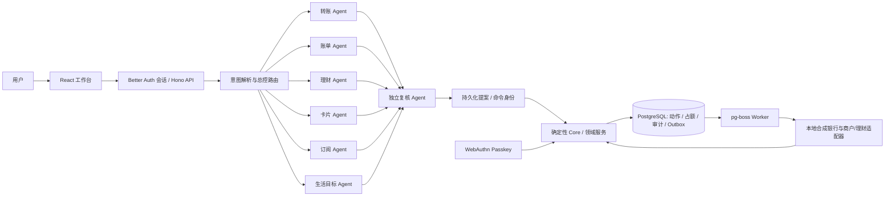

# BankPilot 技术设计与安全机制

## 1. 定位和边界

BankPilot是本地合成银行沙箱中的个人银行事务智能体。用户以自然语言提出请求，模型协助识别意图、安排相关领域并给出结构化提案；独立复核只检查提案完整性与证据一致性。余额、风险、授权、账本与最终执行由确定性服务掌管。模型与复核均不持有资金授权。

账户、交易、卡片、订阅、理财持仓和回执均为合成数据；转账和管理动作通过本地模拟提供方落账，不连接真实银行、商户或支付网络。此实现适合演示和技术验证，不是生产银行服务。

## 2. 架构

LangGraphJS按需并行调度领域节点，之后进入独立复核。服务端把只需的上下文交给各节点；领域输出采用结构化Schema并经确定性校验。领域提案进入待确认状态后，Core/API重新校验用户、动作版本、权限、资金和策略。架构与节点定义见 `packages/agents/src/index.ts`；运行服务组装见 `apps/api/src/main.ts`。

六领域的产品能力范围为转账、账单、理财、卡片、订阅和生活目标。G9W使用当前指定Key完成了一个单场景查询和一组固定的8例已知代表回归；该结果扩大了多域云模型证据，但样本集不是盲测或长期稳定性验证，也不证明完整云模型到资金执行链通过。

## 3. 核心算法与资金路径

### 3.1 请求理解与独立复核

1. 解析原始请求，抽取明确操作及必要实体、金额、日期等槽位；实体与金额由确定性校验器核对，歧义时请求补充，不以模型自由文本补足缺失信息。
2. 总控只激活相关领域。并行领域节点返回对应结构化提案、澄清或拒绝；数据事实由服务端提供。
3. Reviewer检查提案结构、证据和资金预演的一致性。其批准只表示提案可继续进入待确认和Core鉴权，不等于用户授权或执行许可。见 `packages/agents/src/index.ts` 的Reviewer指令与阶段路由。

### 3.2 转账风险、保护和授权

- 金额以整数分表示。`packages/core/src/index.ts` 的当前实现按上海业务日累计金额分档：累计成功与已授权在途金额加本次金额不超过100000分（1000元）为黄档；超过为红档。该数字是源码中的产品策略，不是已核实的赛事评分阈值。
- 草稿准备不扣款。授权时在用户级数据库锁下重算当日累计、可用余额和资金保护；若动作升为红档则动作版本与哈希更新，旧确认失效。执行时再次检查资金保护和授权证明。
- 黄档需要针对该动作的显式确认；红档转账需要服务端校验的WebAuthn Passkey强验证。Core绑定用户、动作哈希、版本与一次性证明，并拒绝过期、重放或已变化的动作。
- 资金预演以当前余额减授权/未知占额，保护最低余额及未来30天内到期或逾期的义务；未来收入不算当前可用现金。预演与确定性 `allowed` 由服务端计算，不由模型覆盖。见 `packages/core/src/finance.ts`。

### 3.3 执行、回执和未知结果恢复

授权、占额、审计和Outbox登记在数据库事务中；Worker以稳定请求身份派发至本地合成银行。模拟银行用幂等键拒绝同键异参，并写入借贷双方分录。服务端收到回执后核对请求身份、账户、收款人、金额、币种和回执内容，再更新本地状态。若提交结果未知，动作保留为`UNKNOWN`并查原单；不允许直接取消或释放占额。相关实现见 `packages/core/src/index.ts`。

理财赎回的`SETTLING`表示已受理但未到账；只有完成提供方回执和分录后才是实际到账，生活目标的后继转账需另行授权。预估日期使用合成工作日历，不含中国法定节假日；预计赎回金额不算当前现金。见 `packages/core/src/investment.ts`。

## 4. 安全机制

- **身份与账户隔离：**API操作从认证会话读取Actor，Core以当前用户范围读取动作并加行锁/用户级事务锁；客户端不传入任意用户ID作为操作身份。
- **权限分级：**普通确认与Passkey强验证分开。红档转账必须有绑定当前动作哈希的`STRONG`证明；WebAuthn校验挑战、Origin、RP ID和`userVerification`，并检查凭据归属当前用户。管理/理财动作各有自己的服务端授权与版本校验。
- **最小授权与二次检查：**提案不是授权。金额、收款人、动作版本、可用余额和资金保护在授权/派发前复查；用户必须针对当前动作确认，变更动作会使旧哈希失效。
- **幂等与对账：**重复命令复用原动作或对异参拒绝；提供方请求身份稳定。`SUBMITTING`/`UNKNOWN`只允许查询和对账，未知不被解释为失败，不盲目重发。
- **审计与数据范围：**动作和授权审计写入数据库；模型仅接收所需上下文，reviewer不取得任意写权限。源代码包不包含本地`.env`或私有状态；演示账号与业务数据为合成数据。

## 5. 当前候选验收状态和限制

- G9Q记录候选源码包新副本安装、构建、类型检查和一项真实生产预览浏览器验证；这些是同一开发工作机上的源码/UI证据，不是外部提交方复现。
- G9U记录较早一个已知合成只读卡片查询中的3次真实模型调用通过；G9W当前Key另通过一个单场景查询，3次HTTP200并满足7项断言。
- G9W在当前候选源码上运行固定的8例已知代表回归（六领域各一个正向例，再加一个转账no-action例和一个卡片clarification例），8/8业务断言通过。20次真实模型请求均成功，0次重试；报告usage输入48222、输出14556，无缺失。来源为固定已知回归，不是盲测、真正未见样本、长期服务稳定性或完整48例验收。
- G9V当前候选资金验证使用隔离实例中的真实UI、API、PostgreSQL、Worker和浏览器，但Planner/provider模式为`scripted`，WebAuthn为虚拟测试器，不是实体Passkey或云端交易。首轮因验收工具把资金占额读取为不存在的`reserved_minor`物理列，在交易发生前失败；修正为SQL聚合后，r2两项2/2通过，首轮失败保留。
- G9V场景A：真实周一T+0合成赎回1000元完成到账，现金余额8000元升至9000元；之后单独准备并确认300.25元付款，余额为8699.75元；刷新、重登后仍显示同一原回执。此为合成提供方结果，不代表真实金融网络清算。
- G9V场景B：600元付款设置`TIMEOUT_AFTER_COMMIT`后进入`UNKNOWN`并保留占额；刷新后手动查原单恢复结果，余额为8099.75元。两次付款累计保留两笔提供方交易、四条借贷分录；手动查单没有增加授权证明。本轮没有验证进程重启或重试。
- G9V使用此前Key时的8次语义阶段HTTP403、0个业务可评样本，作为历史访问记录原样保留，不覆盖或并入G9W。HTTP403原因没有在G9V中确定。
- G9W云模型回归不包含资金授权和付款执行；G9V两场scripted资金流程也不是云模型生成的资金链。不能把两类证据合并声称模型完成云端资金闭环。
- 完整源码独立副本验证：报告结果为134个文件、3420项测试通过，类型检查、构建和清理均通过。源码包名为`BankPilot-G9V-source-with-tests-20261026.zip`，按归档清单与SHA256核对。
- GitHub仓库为[1hb6s7t/BankPilot](https://github.com/1hb6s7t/BankPilot)；接收方复现、Windows兼容和生产环境验收仍待证。
- 详细步骤、失败保留和证据边界见[G9V提交验收记录](../../docs/g9v-submission-validation.md)。
- 当前G9V资金验证使用虚拟WebAuthn；演示需要明确标注这一点，不声称完成实体Passkey验证。
- 当前演示使用本地合成银行、商户和理财数据；没有真实银行/商户接入。模拟provider成功不能证明真实资金支付能力。
- `DEMO_WEEKDAYS_V1`为合成周一至周五日历，没有法定节假日；未知结果只查原单。G9W已知8例通过不能证明盲测泛化、长期稳定性、所有业务输入质量或完整云资金执行。
