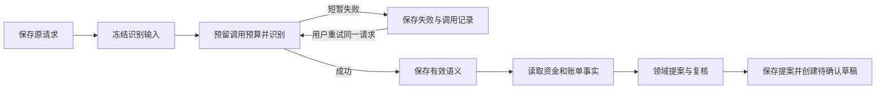

# G8E 语义识别失败与原请求恢复

日期：2026-10-23。G8E 修复 G8D 已复现的缺口：识别服务连续失败后，请求被保存为 `complete`，无法通过原命令重试。当前自动化为 **55 文件、1292/1292**，类型检查和构建通过。浏览器恢复与真实云服务接入分别记录在下方；这些检查不替代六领域语义质量、真实银行或完整项目验收。

## 行为与边界

用户提交请求后，服务端先冻结原文、账户和联系人/产品目录、参考日期，再调用语义模型。短暂服务故障保存为 `failed` 并显示“识别尚未完成”；用户可以显式重试原请求，继续使用同一 command、root、revision 和原始目录。重试不新增用户消息，不用更新后的同名联系人重新解释原请求。

身份配置错误、结构修复耗尽后的无效 JSON/schema/tool 输出、预算耗尽、快照版本或完整性错误会明确停止；它们不会生成用户澄清问题。确实缺金额、对象或日期的有效业务澄清仍然保留。原有严格来源校验与 G8D 的语义修复规则保持，本轮没有修改评测标签或放宽金额、对象、来源与提案相等约束。

语义识别成功后会单独保存结果，随后才读取资金与账单事实。若后续事实准备失败，原请求重试复用已经成功的语义结果。领域规划完成后，继续采用原有顺序：保存提案、使用稳定子命令创建草稿、提交最终结果和助手消息。执行仍须单独取得授权。

每个 command 的累计请求输出上限仍为 **32768 tokens**；每次识别调用上限为 4096。预留在调用前落库，显式重试和租约接管不会获得新的一整份预算。未闭合的尝试保留 `unknown`，不退款。这里的预留是请求上限，不是实际输出、费用或远端接收证明；只有开始记录而没有结果时，不能推断请求一定已发出或成功。没有 usage 的调用继续按未知记载。

过期租约不能提交语义、提案、结果或失败消息，不能继续推进后续阶段。最新请求处于失败/等待状态时，前端清除上一条成功计划的选择，避免把旧确认卡当作当前结果。刷新、切聊天及重新登录从服务端恢复原状态。

## 模块复用与分工

本轮没有新增依赖或替换指定模型。选型沿用已完成的[开源复用调研](../research/2026-10-22/BankPilot-开源复用与模块化决策.md)与 [G8 复用清单](phase8-reuse.md)，精确依赖版本仍由 lockfile 固定。本轮未重新声称上游项目的最新活跃度或维护状态。

| 优先级 | 模块 | 分类与方案 | 判断依据 |
|---|---|---|---|
| P0 | HTTP/严格结构输出 | 适配复用现有 provider、Zod 和 attempt observer | 已有有界重试、deadline、结构重生成和调用错误；补失败分类即可 |
| P0 | 事务、租约与恢复 | 适配 PostgreSQL/pg、现有 command journal、LangGraph/PostgresSaver | 复用行锁、事务、稳定 command 与版本摘要；无需第二套队列或聊天存储 |
| P0 | 跨重试预算及阶段快照 | 项目业务逻辑开发 | 框架不能决定 BankPilot 同一请求预算、目录绑定、失败重试与草稿安全契约 |
| P1 | 对话与身份恢复 | 适配 assistant-ui、React、Better Auth | 使用现有身份及历史接口，只修正失败投影、最新计划选择与重试入口 |
| P1 | 验证与证据 | 直接复用 Vitest、Playwright、隔离 PG fixture | 覆盖真实本地 UI/API/PG；模型故障通过既有可注入 provider 控制 |

开发协作继续使用用户要求的不同能力 Agent：Astra 负责高风险的服务端阶段划分、租约、预算与失败契约；Sol 负责页面状态和真实登录浏览器专项；Luna 独立复核范围和测试缺口；主 Agent 负责真实 API/PG 故障验收、整合、全量回归、源码冻结、运行环境和证据汇总。职责按并发风险、页面状态复杂度及独立复核需要划分；这与产品内部六领域 Agent 分工是两层不同机制。

## 回归与修正证据

初次候选全量为 [1275/1279](../evals/results/2026-10-23-g8e-candidate-tests.json)。4 个失败位于旧 observation 测试：它们期望下游持久化失败后返回普通 `PlanResult`。新契约必须把异常传到 runner，才能保存失败命令。修订保留并增强了“开始写入失败不派发、结束写入失败不重发、保留原错误/请求结果、不进入后续阶段、不返回可消费提案”的断言；新增 4 个真实 runner 加存储替身案例证明失败投影。没有恢复旧的失败吞掉逻辑。

独立复核发现原始无效模型格式被当作用户澄清，先由新增测试复现，随后修正。7 类协议/结构错误现在是不可重试系统失败。另一项复核修正了永久快照故障的重试入口，以及语义已成功、下游预算耗尽时的阶段标题。

最终统一 [1292/1292 自动化报告](../evals/results/2026-10-23-g8e-final-tests.json)包含以下新增专项，合计 74 项；其余为既有回归：

| 专项 | 通过数 | 主要覆盖 |
|---|---:|---|
| 语义服务失败契约 | 22 | 暂时故障、认证失败、7 类协议错误、永久快照、预算分配 |
| PG 规划 journal | 12 | 快照绑定、租约、累计 cap、未知结果保留 |
| 真实 API/PG 与受控 provider | 12 | 原请求恢复、有效语义复用、并发重试、原目录、预算、损坏快照、格式失败 |
| 前端恢复状态 | 24 | 最新命令投影、旧计划清除、会话隔离、失败标题与重试条件 |
| runner 持久化失败边界 | 4 | transfer/reviewer 的开始/结束写入失败，无可消费提案或动作 |

全量还通过了已有真实 SIGKILL 后的并行领域/复核恢复、Core 草稿已提交但最终结果未落库的恢复、API 信号排空、授权、记账、目标依赖和幂等检查。它们不等于语义调用每个时点的进程中断、数据库物理故障或任意网络窗口已经验收。

类型检查通过。构建通过，JS 738.48 kB / gzip 215.61 kB，保留现存单包超过 500 kB 的提示。

源码冻结为 [144 文件 manifest](../evals/baselines/g8e-recovery-2026-10-23T09-49-16-666Z/source-manifest.json)及[快照说明](../evals/baselines/g8e-recovery-2026-10-23T09-49-16-666Z/snapshot-info.json)，不含 `.env`。图版本为 `bankpilot-planner-g8e-v1-lg1.5.2-cp1.2.1-pg1.1.2`，语义快照规则版本为 `bankpilot-semantic-g8e-v1`。旧 prepared snapshot 的目录断言随冻结时点提前而更新；评测器只扩展 `observedStatus` 的 TypeScript 类型以接受 `failed`，预期标签和评分条件未改。

## 浏览器与云服务证据

第一次受控浏览器专项 [1/1 通过](../evals/results/2026-10-23-g8e-controlled-browser.json)，保留[首测证据清单](evidence/g8e-controlled-browser-2026-10-23/evidence-manifest.json)。它使用真实登录、UI、API、PostgreSQL 与受控模型故障，完成旧成功计划 → 两次 502 → 刷新/切聊天/重新登录 → 原请求重试 → 单一新草稿 → 完成重放。不是云模型质量测试。其随机 schema、用户、session、account 和动态端口已清理。

最终冻结版[受控浏览器 2/2 通过](../evals/results/2026-10-23-g8e-controlled-browser-final.json)，总耗时 13.003 秒，retry=0，0 跳过、0 flaky。第一项完成同命令恢复；第二项分别在独立新会话验证无效 schema 与无效 JSON：均为不可重试系统失败，无澄清、重述或重试入口，刷新不追加调用、不新增草稿。余额保持 800000 分、占用 0、提供方转账 0。[最终证据清单](evidence/g8e-controlled-browser-final-2026-10-23/evidence-manifest.json)含 28 份原始 JSON、7 张截图、2 份 trace；144 源码及冻结副本前后零漂移，独立测试账户/schema/端口已清理。主 Agent另查看失败恢复和成功草稿截图。

随后使用同一冻结版本、用户指定的 `DeepSeek-V4.1-Flash-1017-New`、原配置 `json_object` 和同一服务商运行[真实云接入专项](../evals/results/2026-10-23-g8e-live-smoke.json)。**0/1，通过数为 0；5.355 秒后用例失败，retry=0。** 首次识别返回 `MODEL_RESPONSE_JSON_INVALID`，没有进入 transfer/reviewer，未得到草稿。这是服务接入失败，不记为业务成功或已完成的模型质量评测。

只读[模型目录诊断](evidence/2026-10-23-g8e-provider-catalog-diagnostic.json)发现：`https://ai.anna.tf/v1/models` 被重定向到 `https://ai.anna.tf/paused.html`，最终 HTTP 200、`text/html`，标题“服务已暂停”。该 GET 没有发起额外生成请求；它证实当时目录入口返回暂停页，不把它冒充首次 completion 原始响应正文。没有切换服务商/模型，也没有重复运行以挑选成功结果。待服务恢复后须重新独立记录真实接入验收。

[失败后的只读数据库核对](evidence/g8e-live-smoke-2026-10-23/database-after-failure.json)确认：原请求为 `failed`，识别输入已保存、有效语义/提案/result 均未保存；1 条失败调用、预留 4096、usage 未知；1 条用户消息与 1 条失败消息；草稿与提供方转账均为 0，余额 800000 分、占用 0。它说明新失败状态在真实云故障中生效，不能证明成功恢复的云链路已完成。

本地 API 已平稳更新为 G8E，`/api/health` 返回 `mode:model`；Web 仍为 localhost:5178。只执行幂等 API 迁移，没有 demo seed/reset，迁移前后历史计数、账户余额合计、草稿计数与占用一致，见[更新记录](evidence/2026-10-23-g8e-local-upgrade.json)。第一次只读预检误引用派生列，未运行迁移；改为实际占额账本查询后完成，记录保留。

G8D 的 **19/24** 保持为上一版本的已知回归分数；G8E 不沿用该分数，不将单次云接入检查写成新的质量通过率。当前真实云成功接入仍待服务恢复后复验。

## 尚未闭合的项目目标

- 本轮闭合语义识别的短暂故障、原始格式失败和各阶段调用记录错误的处理。领域提案/复核的普通 `ModelProviderError` 仍沿用拒收或复核失败结果，不应宣称所有模型阶段都已支持同一套显式恢复。
- 严格语义来源校验拒绝、生命周期/资金来源误判（例如已知 g722）仍需后续修正和新的质量证据；原文绑定不因本轮改动放宽。
- 旧 `complete` 结果仍只回放，不自动重新解释或恢复为新请求；没有迁移旧失败历史。旧图版本的未完成输入若不兼容会停止，已保存提案按原有可验证上下文与幂等规则续接。
- 数据库连接中断、提交响应未知、物理故障、图内澄清 interrupt、长历史及并发性能仍有未验收范围。检查清单内超过当前测试的条件保持未勾选。
- 尚需独立冻结的新未见样本、六领域/跨域完整演示、空机器复现和比赛交付材料；没有赛事提交或生产金融认证结论。

下一阶段先统一领域/复核失败与业务拒绝的状态，再完善生活目标的日期和资金来源绑定；之后再形成新的冻结质量评测。详见[理想状态基线](ideal-state-acceptance.md)与[独立复核清单](g8e-recovery-acceptance-checklist.md)。
