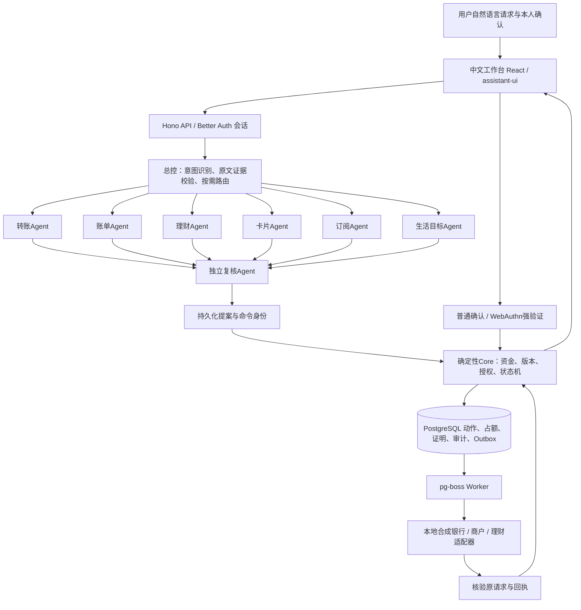
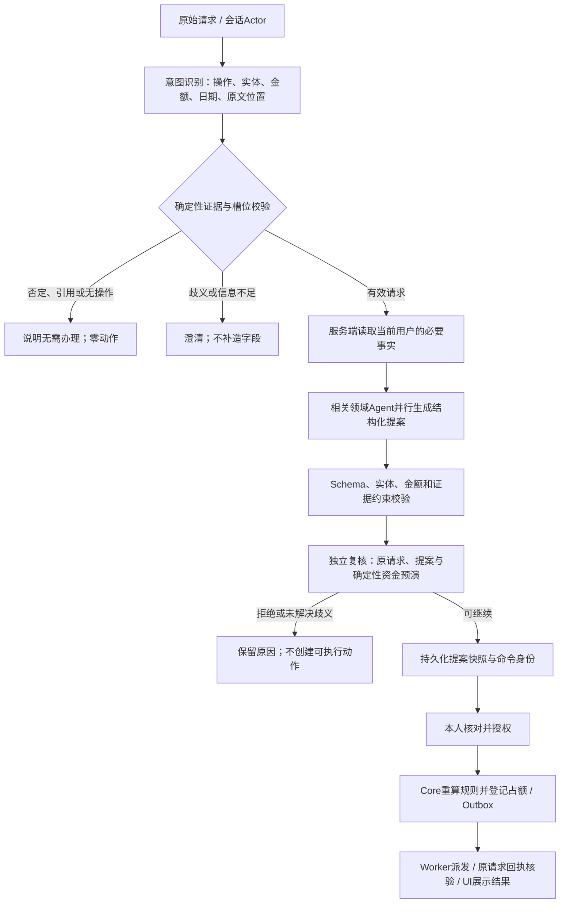
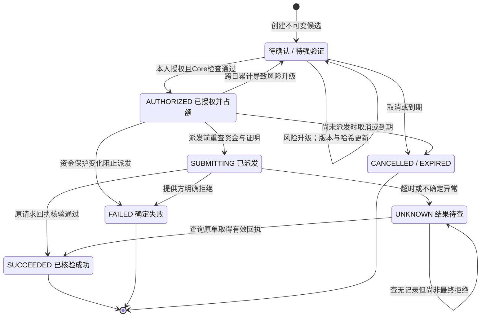

# 安心办 BankPilot——带资金约束的银行事务智能体

## 技术设计文档

材料日期：2026年10月28日。系统范围：本地合成银行沙箱。公开源码入口：[github.com/1hb6s7t/BankPilot](https://github.com/1hb6s7t/BankPilot)。

### 1. 设计理念：让智能理解与资金权限各司其职

银行事务常常同时包含意图、资金和时间条件。例如，“给房东转300.25元，但要留够房租和生活费”不仅需要识别收款人、金额，还要判断余额中哪些已经承诺、哪些必须保留。另一类困难发生在提交之后：网络超时并不意味着付款失败，直接重发可能造成重复付款。

BankPilot把自然语言理解和确定性执行连接为一条可检查的事务链。AI负责识别意图、按需协调领域Agent、形成结构化提案与解释；程序负责资金算术、资源归属、风险分级、本人授权、占额和最终记账。独立复核Agent审查提案完整性与证据一致性，但不持有资金权限。

作品围绕三项设计原则展开：

1. **先说明，再授权。** 用户先看到操作对象、金额、保护资金和预计影响；提案通过复核后仍需本人逐动作确认或强验证。
2. **先约束，再执行。** 资金保护在预演、授权和派发前校验；余额、在途占额和未来预计收入分别表达。
3. **未知结果查原单。** 已派发动作保留原身份和必要占额，以原请求查询回执，避免因超时创建第二笔付款。

| 领域Agent | 主要职责 | 输出或执行边界 |
| --- | --- | --- |
| 转账 | 识别付款意图、精确金额和收款人 | 生成待授权候选；同名或缺字段先澄清 |
| 账单 | 期间、商户或类别分析，引用原始流水 | 确定性计算事实；缺失、不支持与零值分开 |
| 理财 | 查询合成持仓，提出赎回候选 | 逐笔强验证；受理与实际到账分开 |
| 卡片 | 查询状态、准备挂失或解挂 | 状态改变需逐笔强验证 |
| 订阅 | 查询、商户取消、银行扣款拦截 | 查询先授权；合同与扣款限制分别管理 |
| 生活目标 | 将截止日、筹资与付款组织成依赖计划 | 等待实际到账；赎回和付款分别授权 |

所有账户、业务记录、金融产品和提供方均为合成实现。系统用于展示与验证事务控制机制，没有接入真实银行、商户或支付网络。

### 2. 总体架构：总控、六领域与独立复核

领域节点由LangGraphJS按需调度。单域请求只运行有关领域；跨域请求可并行收集提案，再统一进入独立复核。六领域是产品运行架构中的角色；一次请求无需调用全部角色。若意图识别得到“无需办理”、歧义或失败，流程可提前停止，不为凑齐节点而创建动作。

前端只展示服务器返回的提案、动作和回执，不决定用户身份或强验证等级。API从认证会话建立Actor；Core按Actor读取资源，持有用户级事务锁后执行规则。Worker只处理已持久化的动作身份，不能把模型文字直接转成银行指令。

| 层次 | 采用技术 | 作品自行实现的关键契约 |
| --- | --- | --- |
| 交互与接口 | React、assistant-ui、Hono、Better Auth | 当前动作确认、回执展示、会话归属与输入校验 |
| 智能编排 | LangGraphJS、大模型结构化输出、Zod | 意图原文绑定、领域路由、独立复核与拒收规则 |
| 事务执行 | PostgreSQL、pg-boss、SimpleWebAuthn | 资金保护、分级权限、动作哈希、占额与查单状态机 |

组件版本见`package.json`与`pnpm-lock.yaml`；开源复用说明见`THIRD_PARTY_NOTICES.md`。核心入口为`packages/agents/src/index.ts`、`apps/api/src/app.ts`与`packages/core/src/`。

### 3. 数据流与AI核心算法

**原文到结构化意图。** 系统把金额、日期、收款人及操作与原始请求中的证据对应。用户说“不要转账”、引用历史例子或缺少可区分收款人的信息时，应得到零动作或澄清；模型不能自由补全缺失的付款要素。转账备注等已校验字段也需与候选一致。

**领域事实与生成内容分开。** 账户、持仓、卡片、资金预演和账单结果来自服务端；领域节点接收本领域所需上下文。账单的合计、筛选、覆盖状态及流水引用由程序保留，AI核对请求范围并解释，不能把缺失月份当作零消费，或删除商户筛选来回答整月合计。

**独立复核与确定性拒收。** Reviewer接收原问题、已校验意图、领域提案和资金预演，检查结构完整、证据一致及未解决歧义。模型给出`approved=true`仍不能覆盖领域拒收或`allowed=false`。复核通过只允许进入待确认及Core鉴权，不产生授权证明。

**阶段持久化与恢复。** 提案快照、规划阶段和命令身份存储于数据库。恢复使用原快照与稳定命令；租约身份用于阻止失去执行权的旧运行覆盖新结果。业务结果与界面历史分开保存，重新打开页面时从原动作读取最新状态。

本架构不声称多个Agent天然保证正确。它的可检查价值在于：生成输出有契约，事实有来源，拒收有理由，最终写入有独立权限边界。当前云模型证据是固定已知样本回归，具体范围见第8节。

### 4. 资金保护算法：区分余额、可用与可安排

所有金额以**整数分**运算，接口使用整数字符串，数据库使用`bigint`。展示层才格式化为元，避免浮点小数误差。对当前账户定义：

| 记号 | 含义 | 计算规则 |
| --- | --- | --- |
| B | 当前本地已确认余额 | 来自账户记录，不叠加历史账单收入或预期赎回 |
| R | 有效在途占额 | 已授权未过期、提交中与结果未知的转账；执行检查排除本动作自身 |
| A | 当前可用余额 | A = B − R |
| P | 应保护资金 | P = 最低生活保留 + 未来30天内到期及逾期未清义务之和 |
| S | 保护后可安排资金 | S = max(0, A − P) |
| x | 本次拟支出 | 正整数分 |
| H | 支出后的保护缺口 | H = max(0, P − (A − x)) |

资金保护的判断为`allowed = (H = 0)`；金额合法、账户归属和实际余额充足等条件还需分别满足。义务集合按上海业务日期计算，截至当前日期后30天；所有列入规则的义务视为尚未清偿。资金预演不占额，也不自动支付这些义务。

**演示数值。** 初始余额8,000元，无占额；最低生活保留2,000元，未来房租3,000元。因此A=8,000、P=5,000、S=3,000。拟付300.25元后预计可用余额为7,699.75元，保护后仍可安排2,699.75元；拟付4,000元则产生1,000元保护缺口，不能放行。这里“保护5,000元”是政策底线，不是已经扣走5,000元，也不是另一笔在途占额。

保护检查分三个时点：

1. **规划预演：** 向用户解释预计影响；余额变化后旧预演不作为执行凭证。
2. **本人授权：** 在用户级事务锁中重读余额、占额和保护规则，确认后才建立占额。
3. **派发之前：** 再次读取规则；如新增义务使支出突破底线，阻止尚未派发的交易并释放其占额。已经派发而结果未知的交易仍需查原单。

未来工资、订阅取消后预计节省金额、赎回的预计到账与账单历史收入，均不增加当前可用现金。理财的`SETTLING`只表示已受理未到账；核验实际入账后才更新现金。生活目标的截止日期只表示目标时间，不能充当预约扣款许可。

算法依据：`packages/core/src/finance.ts`中的`readFunds`；授权和派发调用见`packages/core/src/index.ts`；理财到账见`packages/core/src/investment.ts`。

### 5. 权限分级与动作绑定

系统将“理解请求”“复核通过”“本人授权”“执行成功”作为不同事件。自然语言说“同意”或Reviewer批准均不直接构成银行执行许可；授权由专门接口和服务端规则完成。

| 操作类别 | 当前实现的等级 | 用户动作与服务端约束 |
| --- | --- | --- |
| 已开放的普通状态、账户、账单、持仓查询 | 会话内只读 | 认证Actor与资源归属；不因此获得付款权限 |
| 订阅明细查询 | 黄档 | 本人明确确认，形成短时查询授权；不能用普通只读查询绕过 |
| 转账日累计含本次≤1,000元 | 黄档 | 本人确认当前动作摘要；Core重算资金、累计和版本 |
| 转账日累计含本次>1,000元 | 红档 | 逐动作WebAuthn强验证；普通确认不足 |
| 联系人别名、订阅商户取消、银行拦截 | 黄档 | 核对目标、资源版本及必要的查询授权 |
| 卡片挂失、解挂和理财赎回 | 红档 | 逐动作强验证；资源或动作变化后旧证明失效 |
| 生活目标 | 按子动作分别授权 | 建立目标不等于授权整条链；赎回与付款独立办理 |

转账源码使用上海业务日，累计口径为成功金额与已授权在途金额，加本次金额；用户级锁使不同任务共享同一累计约束。源码中的边界是**100000分**：恰好1,000元为黄档，超过才为红档。例如两笔600元不能并发获得两个黄档授权；第二笔授权时累计超过阈值，需升级为红档。

风险升级会增加动作版本并重算哈希，使旧确认不再适用。转账动作哈希覆盖用户、动作ID及版本、付款账户、收款人、金额、币种、费用、备注、风险档位、有效期和固定策略版本。证明以用户、动作和哈希为范围，并只能消费一次。

红档使用SimpleWebAuthn验证签名、挑战、Origin、RP ID及用户验证标记；凭据必须属于当前用户。认证挑战绑定当前动作哈希、有效期与用途，使用后消费。通用登录成功不能替代逐笔授权，注册Passkey本身也不是付款。

**规则说明。** 1,000元为当前源码实现策略，现有提交要求仅明确“权限分级”，未附可逐条核对的正式题面风险矩阵。因此本文陈述实现事实，不据此宣称赛事阈值合规。账单中“单笔支出达到1,000元”的提示是另一项统计规则，不等同于转账红档条件，也不是欺诈结论。

依据：`packages/core/src/index.ts`的`tierFor`、`authorize`和`execute`；`apps/api/src/webauthn.ts`；`packages/core/src/management.ts`；`packages/core/src/investment.ts`。

### 6. 可靠执行与失败恢复状态机

授权、占额、授权证明、审计和Outbox在同一数据库事务中登记；Outbox向pg-boss入队与标记已发送也共享事务。银行提交在独立事务发生，因此系统必须处理“银行已记账，应用未收到响应”的间隙，不能假设数据库与外部执行天然原子。

**稳定身份与幂等。** 命令同参返回原动作，异参拒绝；Worker重投仍沿用同一个提供方请求身份。本地合成银行检查幂等键与请求哈希，同键异参拒绝。同一付款的借贷分录各一条，重复查单不创建新付款。

**回执核验。** Core校对提供方请求号、原请求哈希、账户、收款人、金额、币种与回执内容，再同步本地余额和终态。模型或客户端不能提交任意“成功”文本来替代提供方记录。

**未知不释放。** `SUBMITTING`和`UNKNOWN`不允许直接取消，也不因普通到期释放占额。此时`execute`转为查单；查询未找到记录仍可能处于不确定窗口，保持`UNKNOWN`。这意味着可用资金可能暂时受限，但避免把未决款项再次花掉。

理财使用独立占仓与回执，其`SETTLING`需等实际到期入账。生活目标以持久化依赖节点连接“赎回—实际到账—独立付款”，保留成功子动作与回执；重新规划不暗中替换已授权、未知或已成功动作。以上为本地状态机与合成提供方的控制能力，不代表真实银行容灾或清算保证。

### 7. 安全设计、数据边界与工程复现

安全控制围绕六项可核对的不变量组织：动作属于当前用户；金额和对象来自明确请求；保护资金不得越过；红档必须强验证；同一命令不得重复记账；未知结果只查询原请求。这些不变量由API和Core约束，不依赖模型遵守提示词。

| 主要风险 | 当前控制 | 仍需面对的边界 |
| --- | --- | --- |
| 提示注入或模型越权 | 结构化输出、原文证据、实体与金额检查；模型无直接写入权限 | 模型仍可能拒答、遗漏或误解，已知小样本不能证明泛化 |
| 跨用户读取或操作 | 会话Actor、用户范围查询、资源归属检查 | 尚无外部渗透测试或生产身份接入结论 |
| 并发透支与拆单绕过 | 用户级事务锁、整数分、授权时重算累计及占额 | 本机验证不等于生产支付容量与高可用验证 |
| 重放或旧动作授权 | 当前哈希、动作版本、有效期与一次性证明 | WebAuthn不自动提供独立可信的交易明细显示 |
| 提交后响应丢失 | 独立提供方事务、固定幂等键、UNKNOWN保留与原单查证 | 外部机构的最终性、超时与争议流程尚未接入 |
| 演示能力误认为实银行能力 | 界面和材料标注合成银行、受控或真实模型证据来源 | 无真实资金、机构接入或正式安全认证 |

模型仅接收请求所需的服务端上下文，但当前大模型调用可能使用外部模型服务；合成数据实验不构成真实个人金融数据的隐私合规评估。生产使用前需另行确定数据范围、供应商约束、保留与删除策略。当前审计是数据库内可追踪记录，未宣称独立不可篡改存证。

工程采用Node.js 24+、pnpm与Docker/PostgreSQL。全新副本按README安装锁定依赖，复制`.env.example`为本地配置并生成独立认证密钥，然后启动数据库、初始化合成账户、运行API/Web/Worker。真实模型模式需要另行提供可用服务配置；受控模式用于复现确定性业务机制，不能计为云模型质量实验。

评审可从四个入口检查实现：

- `README.md`：环境、启动、示例业务、测试与限制。
- `docs/deployment.md`与`docs/testing.md`：当前部署、隔离测试和复现说明。
- `packages/core/src/`：资金、授权、管理、理财、目标与恢复算法。
- `tests/`及`docs/evidence/`：自动化断言、历史验证记录和结果文件。

提交包应排除运行密钥、`.env`、认证过程原始记录和私有状态。公开源码、可编辑材料、演示视频与验证报告各自说明版本；2026年10月28日已对包含最新界面的独立源码副本重新检查；这不等于从最终ZIP解压后重跑。

### 8. 验证结果与适用范围

| 证据类型 | 已记录结果 | 结论边界 |
| --- | --- | --- |
| 当前指定云模型的固定已知代表集 | 六领域各一正向，另含否定零动作与歧义澄清；8/8业务断言通过，20次HTTP200，零重试、零结构修复 | 已知回归；不等于盲测、长期稳定性或全部业务输入通过；未执行资金授权与付款 |
| 2026-10-28独立源码副本 | 135个测试文件、3,426项测试全部通过；类型检查、构建和隔离库清理通过，进程退出0 | 含最新界面的588文件副本，使用新依赖store；同一开发Mac验证，非接收方、Windows或生产验收；未从最终ZIP解压后重跑 |
| 最新V4资金演示素材 | 受控模型、真实本地API/PostgreSQL/Worker；两笔付款与原单恢复，见下表 | 合成银行；状态截图剪辑，不是连续录屏；没有云模型资金闭环或实体Passkey证据 |

V4使用新建隔离合成账户，最低生活保留2,000元、未来房租3,000元，合计保护5,000元。两笔累计900.25元，均为当前策略黄档，使用本人确认。

| 业务时点 | 本地已确认余额 | 占额 | 资金含义 |
| --- | ---: | ---: | --- |
| 初始 | ¥8,000.00 | ¥0.00 | 保护后可安排¥3,000.00 |
| 第一笔300.25元待确认 | ¥8,000.00 | ¥0.00 | 预演后的¥7,699.75尚不是当前余额 |
| 第一笔确认并完成 | ¥7,699.75 | ¥0.00 | 合成银行付款与回执已落账 |
| 第二笔600元提交后超时 | ¥7,699.75 | ¥600.00 | 本地尚待核验；可用为¥7,099.75；不可再发一笔 |
| 当前页手动查原单完成 | ¥7,099.75 | ¥0.00 | 两笔动作均成功，未新增付款或授权 |

最终数据库记录为`providerTransfers=2`、`ledgerEntries=4`、`authorizationProofs=2`。V4没有刷新页面步骤，也未使用Passkey；其页面“真实模型模式”文字是夹具配置标签，不能证明云模型运行。影片持续标注“本地合成银行·受控模型”。

另有历史受控资金验证记录，包括合成赎回到账后独立付款，以及刷新后查询原回执；它们与V4不是同一账户、余额或测试。历史虚拟WebAuthn验证也不等于实体认证器验收。此前模型HTTP403访问记录保留在原报告，不被后续成功回填。

**证据索引。** 模型：`docs/g9w-provider-revalidation.md`及其链接的原始结果；源码：`docs/evidence/2026-10-28-submission-source-verification.json`；历史资金：`docs/g9v-submission-validation.md`；V4：`docs/submission/video-evidence.md`。本材料为比赛提交文稿，不构成生产金融服务、安全认证或已提交门户的证明。截止日2026年11月2日来自用户提供的要求，未在本次独立核验官网。
